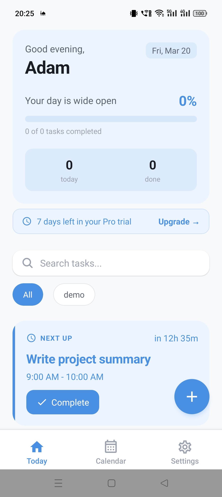
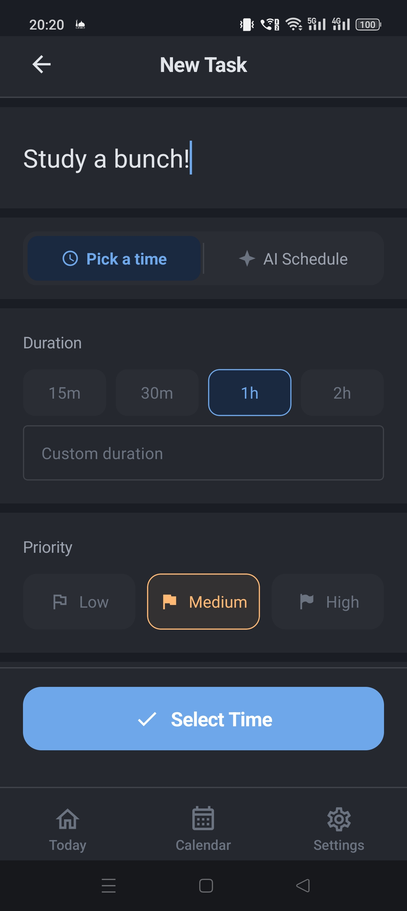
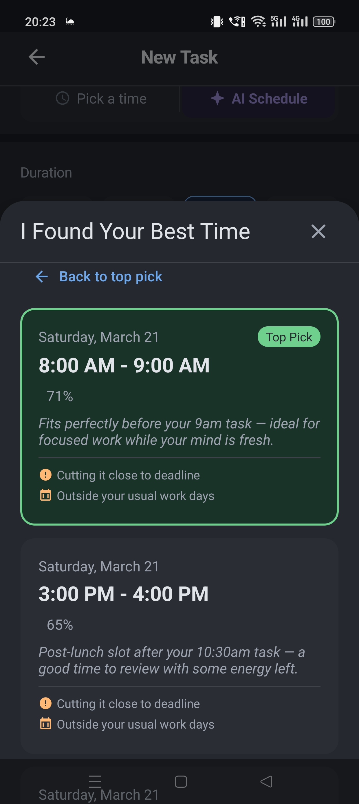

# TailoredTime (DayWise)

> AI scheduling that adapts to how *you* work.

A React Native / Expo mobile app that schedules tasks around your personality and your real calendar, and explains why it picked each slot. Backed by Supabase (Postgres + RLS + Edge Functions) and OpenAI. Android-first; iOS builds are supported through EAS.

The app ships under the name **DayWise** (see [app.config.js](app.config.js)); **TailoredTime** is the original project name and is still used in the code and docs.

<p align="center">
  
  
  
</p>

---

## What it does

Most calendar apps only find a free gap. TailoredTime scores free gaps against a personality profile built during onboarding:

| Dimension | Example spectrum |
|-----------|------------------|
| Chronotype | night owl ↔ early bird |
| Focus duration | short sprints ↔ deep work blocks |
| Deadline style | early starter ↔ deadline-driven |
| Break needs | frequent breaks ↔ long sessions |
| Task switching | single-task ↔ multi-task |
| Schedule flexibility | rigid ↔ fluid |

Each scheduled task comes with a reason, e.g. *"Tuesday 7pm: you're a night owl and prefer 2-hour blocks."*

### Features

- Email and Google sign-in (Supabase Auth, PKCE), password reset and email verification
- Onboarding quiz, first-task flow and a guided tour
- Smart scheduling (AI-ranked) and manual scheduling, with task splitting and recurring tasks
- Two-way Google Calendar sync; existing events are treated as busy time and can be opened in-app
- Home, calendar (day / week / month) and per-task views
- Auto-reschedule of missed or conflicting tasks (Edge Function)
- Push notifications, offline support with sync queue, and timezone handling
- Subscriptions and trial via RevenueCat, with AI usage limits and rate limiting
- In-app feedback, admin dashboard, and Sentry / PostHog instrumentation
- Account deletion (Edge Function)

---

## How scheduling works

Scheduling is two-stage so the AI only sees a small, relevant set of candidates:

1. **Pre-filter** ([lib/scheduling-algorithm.ts](lib/scheduling-algorithm.ts)): generates candidate slots across a look-ahead window (default 14 days), removes conflicts with calendar events, and scores each slot from 0 to 100 using the personality profile, deadline, priority, task type, back-to-back load and break needs. Slots under a minimum score are dropped and the top 20 are kept.
2. **AI ranking** ([supabase/functions/rank-slots](supabase/functions/rank-slots/index.ts)): the candidates are sent to an Edge Function that calls `gpt-4o-mini` server-side and returns a ranked list with a human-readable reason for each. The OpenAI key never reaches the client.

[lib/scheduling.ts](lib/scheduling.ts) orchestrates both stages and falls back to the algorithmic ranking if the AI step fails. Design rationale is in [SCHEDULING_ALGORITHM_DECISIONS.md](SCHEDULING_ALGORITHM_DECISIONS.md).

---

## Tech stack

| Layer | Technology |
|-------|-----------|
| App | React Native 0.81, React 19, Expo SDK 54 (new architecture) |
| Routing | Expo Router (file-based) |
| UI | React Native Paper, Reanimated, Gesture Handler |
| Backend | Supabase: Postgres with row-level security, Auth, Edge Functions (Deno) |
| AI | OpenAI `gpt-4o-mini` via Edge Function |
| Calendar | Google Calendar API, `@react-native-google-signin/google-signin` |
| Payments | RevenueCat (`react-native-purchases`) |
| Monitoring | Sentry, PostHog |
| Storage | `expo-secure-store` for tokens, AsyncStorage for non-sensitive data |
| Language / tests | TypeScript, Jest + ts-jest |

---

## Project structure

```
app/
  (auth)/          login, onboarding, first-task, email verification, password reset
  (tabs)/          home, calendar, add-task, settings
  settings/        account, personality, stats
  task/[id].tsx    task detail
  admin/           admin dashboard and feedback review
  auth/, oauth2redirect.tsx   auth and Google OAuth callbacks
  paywall.tsx      subscription paywall
components/        timelines, scheduling modal, slot picker, tour, feedback, sheets
contexts/          Auth, Theme, Network, Subscription, GuidedTour
lib/               scheduling, scheduling-algorithm, openai, google-calendar,
                   sync, offline, recurrence, timezone, notifications, purchases, ...
  __tests__/       Jest unit tests
supabase/
  migrations/      001-029 SQL migrations (schema, RLS, security hardening)
  functions/       rank-slots, auto-reschedule, delete-account,
                   google-oauth-redirect, revenuecat-webhook
plugins/           Expo config plugin (phone-only)
scripts/           test-data generator and AI reasoning test
```

---

## Getting started

### Prerequisites

- Node.js 18+
- A Supabase project and the [Supabase CLI](https://supabase.com/docs/guides/cli)
- A Google Cloud project with the Calendar API enabled
- Android device or emulator. The app uses native modules (Google Sign-In, RevenueCat, Sentry), so **Expo Go will not work**; use a development build.

### Install and run

```bash
git clone https://github.com/Kadam-A/tailoredtime.git
cd tailoredtime
npm install
cp .env.example .env        # then fill in values (see below)

npx expo run:android        # builds and launches a dev build
npx expo start --dev-client # subsequent runs
```

### Environment

Copy [.env.example](.env.example) to `.env`. Everything prefixed `EXPO_PUBLIC_` is embedded in the app bundle, so only put public values there:

| Variable | Purpose |
|----------|---------|
| `EXPO_PUBLIC_SUPABASE_URL`, `EXPO_PUBLIC_SUPABASE_ANON_KEY` | Supabase client (protected by RLS) |
| `EXPO_PUBLIC_GOOGLE_CLIENT_ID_ANDROID` / `_IOS` / `_WEB` | Google OAuth client IDs |
| `EXPO_PUBLIC_SENTRY_DSN`, `EXPO_PUBLIC_POSTHOG_API_KEY` | Optional monitoring |

Never put the OpenAI key or the Supabase service-role key in the app. See [SECURITY.md](SECURITY.md).

### Backend

```bash
supabase link --project-ref <your-ref>
supabase db push                                   # apply migrations 001-029
supabase secrets set OPENAI_API_KEY=sk-...         # server-side only
supabase functions deploy rank-slots
supabase functions deploy auto-reschedule
supabase functions deploy delete-account
supabase functions deploy google-oauth-redirect
supabase functions deploy revenuecat-webhook
```

---

## Development

```bash
npm test               # Jest unit tests
npm run test:coverage
npm run lint
npx tsc --noEmit       # type check
npm run test:ai        # AI reasoning check (needs local scripts/.env.test)
```

Builds use EAS (`eas.json` is gitignored because it holds environment config):

```bash
eas build --platform android --profile preview      # APK
eas build --platform android --profile production   # AAB
```

---

## Documentation

- [DECISIONS.md](DECISIONS.md): architecture decisions
- [SCHEDULING_ALGORITHM_DECISIONS.md](SCHEDULING_ALGORITHM_DECISIONS.md): scheduling spec
- [SECURITY.md](SECURITY.md): security requirements
- [POST_V1.md](POST_V1.md): roadmap
- [CHANGELOG.md](CHANGELOG.md): version history

---

## Author

Built by [Kadam-A](https://github.com/Kadam-A).
